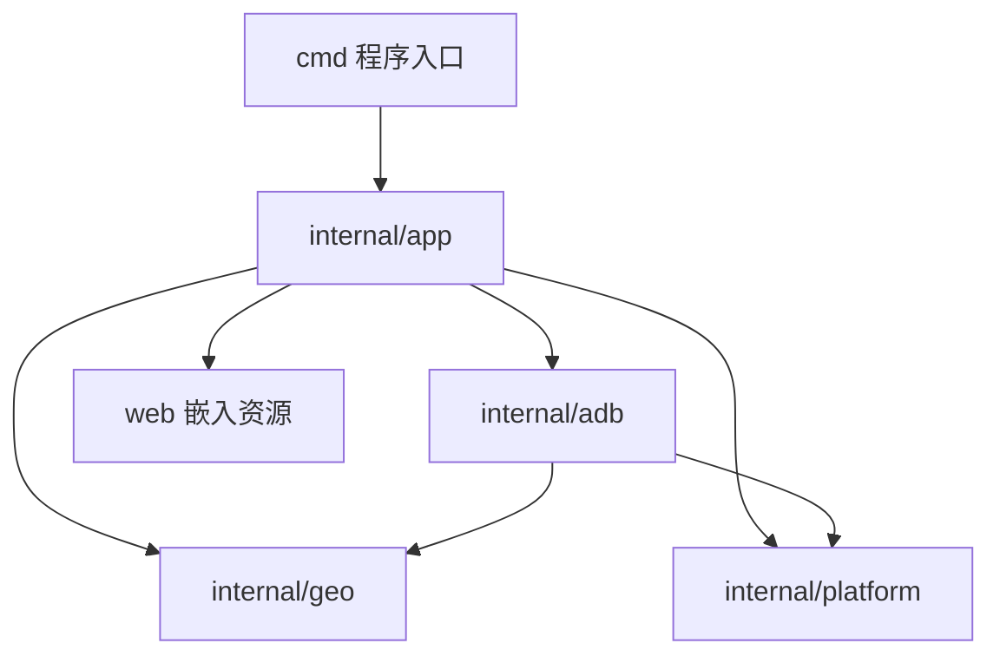

# 架构与实现范围

这份文档合并并替代原先的需求草稿与实施方案，描述当前实现。

## 目标

面向自用的电脑端 Android 模拟定位工具：手机零额外安装，通过已有 ADB 连接，在本地网页中选点并持续模拟 GPS。首版以 Windows 为主要运行环境，其他平台保留基础适配。

当前包含固定点模拟、坐标更新、地图与手动输入、会话恢复和只读诊断。中文搜索、地点收藏、键盘移动和轨迹回放留待出现实际需求后再实现。不引入账号、数据库、前端构建工具或手机端程序。

## 目录与依赖

| 位置 | 职责 |
| --- | --- |
| `cmd/adb-fake-location/main.go` | 调用应用入口、打印错误与设置退出码 |
| `internal/app/run.go` | 解析参数、初始化配置、监听本地服务、处理退出 |
| `internal/app/server.go` | HTTP 接口、请求校验、同源与会话令牌检查 |
| `internal/app/session.go` | 会话状态、唯一注入任务、生命周期串行化 |
| `internal/app/recovery.go` | 恢复记录格式、原子落盘与清理进度 |
| `internal/app/config.go` | 地图配置及默认值 |
| `internal/app/diagnostics.go` | 独立只读诊断，不进入会话或退出恢复流程 |
| `internal/adb/` | 执行 ADB 子进程，处理超时、设备选择、命令与输出兼容 |
| `internal/geo/` | 与设备、HTTP 无关的坐标校验和转换 |
| `internal/platform/` | 用户数据目录、操作系统单实例锁与隐藏子进程窗口 |
| `web/` | 页面、样式、交互代码和本地 Leaflet；统一嵌入可执行文件 |

同一业务模块仍按文件划分职责，不为每个结构体建立独立包。HTTP 与会话同属应用模块，ADB 和纯坐标计算有明确的依赖边界。测试与被测包放在一起，测试用 ADB 模拟器保存在 `testdata/fakeadb/`。

## 定位与恢复

1. 开始前重新确认目标设备、命令能力、系统定位开关和现有提供商。
2. 记录原 shell UID 的 AppOps 模式，在每项设备修改前先保存恢复意图。
3. 创建 `gps` 测试提供商并首次注入成功后，启动唯一后台任务。
4. 后台约每秒发送一次；坐标变更合并交给同一任务，API 不另开并发注入。
5. 停止先取消并等待后台任务退出，再移除测试提供商、还原本工具改变的授权。
6. 只有所有清理步骤完成才删除恢复文件；失败保留已完成步骤和待处理状态。

状态包括不可用、就绪、启动中、模拟中、停止中、待清理。待清理时不能开启新会话。旧记录或损坏记录不自动覆盖。

网页约每秒读取状态。设备就绪且未模拟时，成功的设备探测缓存 3 秒，减少 ADB 调用；真正开始时始终重新检查，不依赖缓存。

用户数据目录与 EXE 位置、当前工作目录无关，移动程序后仍能找到旧恢复记录。单实例锁由操作系统持有，进程异常退出不会留下永久锁。

## 网页与配置

Go 标准库提供仅绑定 `127.0.0.1` 的服务；原生 JavaScript 调用本地 API，Leaflet 管理地图交互。

- 地图候选位置与最近成功发送的位置分开显示。
- GCJ-02 输入先转换为 WGS-84；在 GCJ-02 底图回显时再按底图坐标转换。
- 未配置用户文件时使用现有默认瓦片；显式配置缺失或错误则提示原因，保留坐标输入功能。
- 瓦片来源和坐标系通过配置指定，不自动猜测，不混用多个地图 SDK。
- 地图图片仍需联网。当前瓦片可用不代表长期开放承诺；需要时可重新评估高德官方 API。
- 定位修改接口要求同源和会话令牌，严格校验坐标及请求格式，不暴露任意命令执行。

主要接口：`GET /api/bootstrap`、`GET /api/status`、`POST /api/preview`、`POST /api/start`、`POST /api/location`、`POST /api/stop`、`POST /api/recover`。

## 已知边界

- 设备版本只是参考，必须探测实际命令能力。完整帮助输出返回 255 的兼容处理只适用于只读帮助命令。
- 模拟位置有 mock 标记，不等于改写卫星硬件、SDK 自身定位服务或所有应用的缓存。
- GPS 测试提供商生效不保证所有应用采用它。高德、腾讯的当前实测结果见 [兼容性记录](compatibility.md)。
- 关闭网页不会停止模拟；断连时电脑无法保证立即清理，必须恢复连接后处理。
- 删除测试提供商后，真实定位与应用显示可能需要下一次真实数据更新。本次真机试验已经结束并完成恢复。

不会为了未经验证的应用兼容性默认扩展系统改动范围。后续优化优先考虑用户确实需要的界面和操作功能。

## 构建与维护

入口固定为 `go run ./cmd/adb-fake-location`。`scripts/build.ps1` 统一生成 `dist/adb-fake-location.exe`，编译产物不进入源码目录或版本管理。

原有 GoGoGo 文件夹只是参考克隆，没有运行或构建依赖，已从工作目录清除。需要参考时访问 [GoGoGo 上游仓库](https://github.com/ZCShou/GoGoGo)。网页随附 Leaflet 1.9.4 及其许可证。
